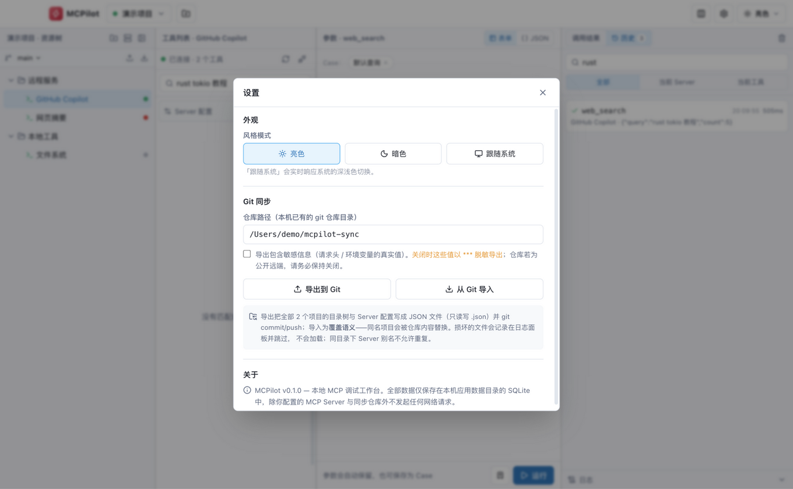
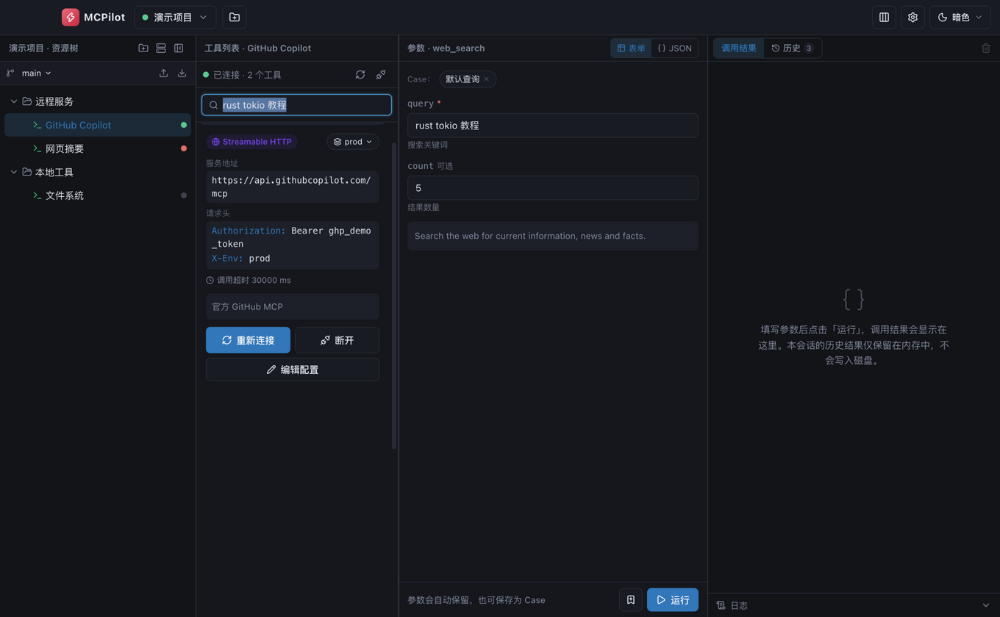

# MCPilot — 本地 MCP 调试工作台

MCPilot 是一个跨平台的 [MCP (Model Context Protocol)](https://modelcontextprotocol.io) Inspector 桌面客户端，基于 **Tauri 2 + React** 构建。

以「项目 → 目录 → Server」的方式组织你的 MCP Server，提供 **资源树 → 工具列表 → 参数表单 → 调用结果** 四栏工作台。


> **隐私承诺**：全部数据（项目/目录/Server 配置/请求头中的鉴权信息）仅保存在本机应用数据目录的 SQLite 中，应用不接入任何遥测/统计/上报，运行期间除你主动配置的 MCP Server 地址与同步仓库外不发起任何网络请求。

## 功能总览

### 项目与资源树

- 多项目管理，左上角随时切换；「管理项目」弹窗集中完成全部项目的重命名、配置与删除；同步目录支持手动输入或**从文件系统挑选**（自动 git init），资源树栏头可一键在文件管理器中打开项目目录
- 目录无限嵌套、拖拽移动、右键管理；展开/收起带动画，展开状态按项目记忆（重启/切换项目后保持），整栏可折叠
- Server 按协议类型着色标识（stdio 绿 / Streamable HTTP 紫）与连接状态点

### Server 连接

- **双传输**：stdio（本地子进程，可配参数/环境变量/工作目录）与 Streamable HTTP（远程）
- **自定义请求头**：Authorization 等鉴权信息，连接时自动携带
- **项目级环境变量（Apifox 式 `{{}}` 引用）**：变量集中项目环境库里定义与修改（顶栏「环境」），同一项目内所有 Server 共享；Server 配置的值里以 `{{变量名}}` 引用（地址/命令/参数/环境变量/请求头均支持），连接时按顶栏切换的**全局环境**插值替换——编辑 Server 与编辑环境变量完全解耦，互不影响；存在未定义引用时连接直接报错提示（不把占位符原样发出）；每个项目记住自己的环境选择，旧版每-Server 环境组数据**自动合并迁移**进环境库（冲突逐条写日志、旧数据保留可回退）
- 单击查看配置摘要（命令/URL/headers/超时/当前环境），双击或点按钮才发起连接；支持一键重连

### 工具调用

- JSON Schema 自动生成参数表单（枚举下拉、默认值、必填校验），支持 表单 / JSON 双模式
- **参数自动保留**：跨工具切换、甚至重启应用后自动回填；可保存为命名 **Case** 一键带入
- 调用带超时保护；结果支持 JSON 折叠树 / 原始文本切换、结构化内容与入参对照、一键复制

### 调用历史

- 全局历史（跨工具/项目，落盘保留最近 500 条）：条目带自增编号（最新最大）；搜索关键字（工具名/Server/入参），按 全部/当前 Server/当前工具 过滤，条目点击展开完整详情，滚动到底动态加载更早记录


### Git 同步

- **项目级**（管理项目弹窗绑定同步目录 + 资源树同步条）：分支切换、推送（导出+commit+push）、拉取（pull+覆盖导入）
- **实时同步**：新建/改名/移动/删除/复制节点、保存 Server 配置后自动把变更写入同步目录（300ms 防抖，成功静默、失败记入日志面板），文件始终与工具内数据一致；git 提交/推送节奏仍由推送按钮手动控制
- **未推送变更提醒以 git status 为准**：同步条徽标/变更列表/树黄点直接读同步目录 `git status`（10s 轮询 + 实时写盘后刷新）——新建又马上删除不留残余条目、重启应用后未推送提醒不丢失、外部直接改动的文件同样可见；推送成功后工作区干净，提醒自然消失
- **仓库目录结构镜像资源树**：分组 = 真实子目录、Server = 其分组目录下的 `<别名>.json`（根层 Server 直接放仓库根），另有 `tree.json` 记录结构元数据（原名/层级/排序）；空分组自动写 `.gitkeep` 占位（git 不跟踪空目录）
- **Server 配置完整持久化到 json**：连接配置 + 项目环境库（`environments.json`：全部环境与变量集）一并导出/恢复，**明文写入**（json 即完整可用配置，拉取导入即得全部真实值；⚠️ 同步目录与远端仓库会包含明文鉴权信息，请勿推送到公开远端）；跨目录同名 Server 完全合法（不同分组可同名互不覆盖）；同目录同类型不允许重名——新建/重命名/移动/复制时**实时检查并阻止保存**，历史遗留的磁盘名冲突由推送自动加 `-2` 后缀消解
- 只扫描 `.json`，损坏文件记入日志并跳过不加载；支持手工往分组目录放置配置文件再拉取导入（按所在目录挂载）
- **拉取防覆盖保护**：有远端时从远端分支快照导入（不触碰本地未提交文件）；拉取前检测到本地有未推送改动时提醒「建议先推送」，避免本地改动被远端覆盖
- 旧版拍平布局（`servers/*.json`）的仓库拉取自动兼容，首次推送自动升级为树形布局

### 外观

- 亮色 / 暗色 / **跟随系统** 三态（实时响应系统切换），主色调天蓝






### 其他

- 可折叠日志面板：Git 同步、连接失败等运行记录（仅内存）
- 四栏宽度可拖拽 + 一键均分
- 快捷键 `⌘,`（macOS）/ `Ctrl+,`（Windows/Linux）打开设置
- 原生菜单「检查更新」：macOS 在左上角苹果 logo 旁的应用菜单，Windows/Linux 在窗口顶部菜单栏（应用 → 检查更新），点击后打开设置页「关于」并自动检查，检查/下载/安装流程与设置页完全一致
- 更新日志：仓库根 `CHANGELOG.md` 是唯一数据源——发版时 CI 自动提取最新版本段落作为 Release 正文与在线更新的日志内容（应用内检查到新版本时直接在下方显示框展示）；该文件同时随应用打包内置，「设置 → 关于 → 查看本次版本更新日志」离线可查

## 界面说明

| 栏 | 内容 |
|---|---|
| 资源树 | 项目内目录/Server 树、同步条（分支/推送/拉取）、连接状态点 |
| 工具列表 | 选中 Server 的工具（搜索过滤）、连接状态、可折叠配置摘要（含当前环境徽标） |
| 参数 | Schema 表单 / JSON 双模式、Case 条、运行 |
| 调用结果 | 结果卡片、历史标签页、可折叠日志 |

## 开发

```bash
pnpm install
pnpm app:dev      # 开发模式（tauri dev 托管，热更新，Ctrl+C 退出）
pnpm app:run      # 快速调试（增量编译 debug 版 app 并直跑，连 vite 热更新，窗口秒开）
pnpm app:demo     # 浏览器演示模式（免编译 Rust，自动开浏览器，内置 mock 数据）
pnpm app          # 打包并运行产物
pnpm app:build    # 只打包不运行
```

依赖：Node 18+、pnpm、Rust stable（Tauri 官方要求）。

纯浏览器打开 `http://localhost:1420` 会进入**演示模式**（内置演示数据 mock，仅 dev 构建生效），便于 UI 开发与截图。

### 打包与系统要求

推送 `v*` 标签（如 `git tag v0.1.0 && git push origin v0.1.0`）触发 GitHub Actions（`.github/workflows/build.yml`）三平台自动打包，并创建 Release 附全部安装包：

| 平台 | 产物 | 最低系统版本 |
|---|---|---|
| macOS | `.app` / `.dmg`（universal：Intel + Apple Silicon 合包） | macOS 10.15+（Apple Silicon 机型实际要求 11+） |
| Windows | NSIS 安装包（x64） | Windows 10+（WebView2 运行时要求） |
| Linux | `.deb` / `.rpm` / `.AppImage`（x64） | glibc 2.35+（Ubuntu 22.04+ / Debian 12+ / Fedora 36+） |

macOS 图标需保留官方网格边距（主体 824 居中）：`tauri icon` 后再执行 `node scripts/gen-macos-icns.mjs <1024源图>` 重新覆盖 `icon.icns`（`tauri icon` 会裁掉透明边距导致 Dock 图标偏大）。

手动触发（workflow_dispatch）也可以打包，产物在工作流的 Artifacts 里下载，不创建 Release。

发版时需在仓库根 `CHANGELOG.md` 顶部新增对应 `## vX.Y.Z（日期）` 段落：CI 自动提取它作为 Release 正文与 latest.json 的 notes（即应用内「检查更新」的更新日志内容）；未维护段落时自动回退通用文案，不阻塞发版。

### 数据存储位置

| 平台 | 路径 |
|---|---|
| macOS | `~/Library/Application Support/com.mcpilot.app/mcpilot.db` |
| Linux | `~/.local/share/com.mcpilot.app/mcpilot.db` |
| Windows | `%APPDATA%\com.mcpilot.app\mcpilot.db` |

### 内置示例 Server（examples/）

```bash
# Streamable HTTP 演示（端口 3927）
node examples/http-server.mjs
```

- `examples/stdio-server.mjs` — stdio 演示，提供 `echo` / `add` 两个工具；
- `examples/http-server.mjs` — Streamable HTTP 演示，提供 `upper` 工具，会校验 `Authorization` 头。

## 安全说明

- 所有 SQL 使用 prepared statement，防注入；git 命令参数数组执行
- 请求头 / 环境变量等敏感值不写日志、不出现在错误信息中（自动脱敏，含 `{{}}` 插值解析后的值）
- 已知取舍：敏感配置目前**明文存于本机数据库**（与官方 MCP Inspector 行为一致）；Git 同步目录的 json 同样**明文写入**（保证拉取即得完整可用配置），远端仓库请选择私有仓库；后续可接入操作系统 Keychain 做加密存储
- Tauri capability 最小化（仅 `core:default` + 窗口拖动 + updater/process/dialog 插件所需权限），生产构建启用严格 CSP

## 版权说明

- 本项目基于 [MIT License](LICENSE) 开源发布，Copyright (c) 2026 纯白约定
- 任何人可免费使用、复制、修改、合并、发布、分发、再许可与销售本软件及其副本，唯一保留条件是在所有副本中包含原版权声明与许可声明
- 项目中引用的第三方组件（Tauri、React、rmcp 等）归其各自作者所有，遵循其原始协议分发

## 免责声明

- 本软件按「现状」提供，不附带任何明示或默示的保证，包括但不限于适销性、特定用途适用性与不侵权的保证
- 本应用是连接与调试 **MCP Server 的工具**：你自行配置和连接的 MCP Server 属于外部程序，因其行为产生的任何后果（数据变更、文件操作、命令执行、数据泄露等）由使用者自行判断并承担
- 通过本应用与第三方 MCP Server、网络服务交互时传输的数据不在本应用的控制范围内，请自行评估对端可信度，谨慎配置含鉴权信息的请求头与环境变量
- 敏感配置目前明文存于本机数据库（见「安全说明」），请勿在不可信的设备上使用
- 在任何情况下，作者或版权持有人均不对因使用或滥用本软件而产生的任何索赔、损害或其他责任负责
- 本项目为独立的社区工具，与 MCP 协议官方及 Anthropic 无任何隶属或背书关系
