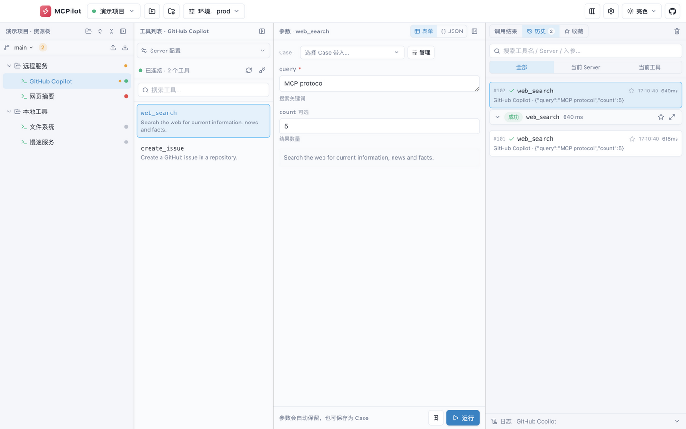

# MCPilot — 本地 MCP 调试工作台

跨平台的 [MCP (Model Context Protocol)](https://modelcontextprotocol.io) Inspector 桌面客户端，基于 **Tauri 2 + React** 构建。

以「项目 → 目录 → Server」组织你的 MCP Server，四栏工作台一气呵成：**资源树 → 工具列表 → 参数表单 → 调用结果**。


> 🔒 **隐私承诺**：全部数据（项目 / 配置 / 请求头里的鉴权信息）只存在本机 SQLite，无遥测、无统计、无上报；除你主动配置的 MCP Server 地址与同步仓库外，不发起任何网络请求。

## ✨ 功能一览

### 🗂 项目与资源树

- 📁 **多项目**管理，目录无限嵌套、拖拽移动；展开状态跨重启记忆
- 🏷️ Server 按协议着色（stdio 🟢 / Streamable HTTP 🟣）+ 连接状态点

### 🔌 Server 连接

- **双传输**：stdio 本地子进程（可配参数 / 环境变量 / 工作目录）· Streamable HTTP 远程
- 🔐 **自定义请求头**：Authorization 等鉴权信息连接时自动携带，历史记录中自动打码
- 🌿 **项目级环境变量**：变量集中定义，配置里 `{{变量名}}` 引用，按环境一键切换（dev / prod…）；引用未定义变量时连接直接报错，不把占位符原样发出
- 单击看配置摘要，双击才发起连接；一键重连

### 🛠️ 工具调用

- 📋 JSON Schema 自动生成参数表单（枚举下拉 / 默认值 / 必填校验），**表单 / JSON** 双模式
- ♻️ **参数自动保留**：跨工具切换、重启应用都自动回填；可存命名 **Case** 一键带入
- ⏱️ **超时保护 + 随时手动取消**（按 MCP 规范通知 server 停止）
- 🧾 结果支持 JSON 折叠树 / 原始文本切换、结构化内容与入参对照、一键复制、复制为 cURL

### 🕘 调用历史

- 🌐 全局历史跨工具 / 项目，落盘保留最近 **500 条**；搜索 + 按 全部 / 当前 Server / 当前工具 过滤
- ⭐ 收藏记录永久保留；条目展开即完整详情（请求头 / 入参 / 响应三段对照）



### 🔄 Git 同步

- 📦 项目绑定同步目录（自动 git init）：**推送** = 导出 + commit + push，**拉取** = pull + 导入
- ✍️ **实时同步**：改目录 / 存配置自动写盘（300ms 防抖），文件与工具内数据始终一致
- 🛡️ **拉取防覆盖**：本地有未推送改动先提醒；有远端时从远端快照导入，不碰本地未提交文件
- 🗄️ 仓库结构镜像资源树：分组 = 子目录、Server = `<别名>.json`，配置含环境库完整可回灌
- ⚠️ json **明文写入**，同步目录与远端会包含鉴权信息，请使用私有仓库

### 🎨 外观与细节

- 🌗 亮色 / 暗色 / **跟随系统** 三态主题（实时响应系统切换）


- 🪟 四栏宽度可拖拽 + 一键均分；可折叠日志面板
- ⌨️ `⌘,` / `Ctrl+,` 打开设置；应用内检查更新 + 内置更新日志

## 🚀 开发

```bash
pnpm install
pnpm app:dev      # 开发模式（tauri dev 托管，热更新，Ctrl+C 退出）
pnpm app:run      # 快速调试（增量编译 debug 版 app 并直跑，窗口秒开）
pnpm app:demo     # 浏览器演示模式（免编译 Rust，内置 mock 数据，便于 UI 开发与截图）
pnpm app          # 打包并运行产物
pnpm app:build    # 只打包不运行
```

依赖：Node 18+、pnpm、Rust stable（Tauri 官方要求）。

### 打包与系统要求

推送 `v*` 标签（如 `git tag v0.1.0 && git push origin v0.1.0`）触发 GitHub Actions 三平台自动打包并创建 Release；发版时在 `CHANGELOG.md` 顶部新增版本段落，CI 自动提取为 Release 正文与在线更新的日志内容。

| 平台 | 产物 | 最低系统版本 |
|---|---|---|
| macOS | `.app` / `.dmg` | macOS 10.15+（Apple Silicon 实际要求 11+） |
| Windows | NSIS 安装包（x64） | Windows 10+ |
| Linux | `.deb` / `.rpm` / `.AppImage`（x64） | glibc 2.35+（Ubuntu 22.04+ 等） |

### 数据存储位置

| 平台 | 路径 |
|---|---|
| macOS | `~/Library/Application Support/com.mcpilot.app/mcpilot.db` |
| Linux | `~/.local/share/com.mcpilot.app/mcpilot.db` |
| Windows | `%APPDATA%\com.mcpilot.app\mcpilot.db` |

### 内置示例 Server（examples/）

```bash
node examples/http-server.mjs   # Streamable HTTP 演示（端口 3927）
```

- `examples/stdio-server.mjs` — stdio 演示，提供 `echo` / `add` 两个工具
- `examples/http-server.mjs` — Streamable HTTP 演示，提供 `upper` 工具，会校验 `Authorization` 头

## 🔒 安全说明

- 所有 SQL 使用 prepared statement 防注入；git 命令参数数组执行
- 请求头 / 环境变量等敏感值不写日志、不出现在错误信息中（自动脱敏，含 `{{}}` 插值后的值）
- 已知取舍：敏感配置**明文存于本机数据库**（与官方 MCP Inspector 一致），后续可接入系统 Keychain 加密
- Tauri capability 最小化，生产构建启用严格 CSP

## 📄 版权与致谢

基于 [MIT License](LICENSE) 开源发布，Copyright (c) 2026 纯白约定。

本项目站在开源社区的肩膀上，衷心感谢以下核心组件及其全部传递依赖的作者（各组件的原版权与许可声明随其源码一并分发，如有出入以组件自带的 LICENSE 为准）：

**前端**

| 组件 | 用途 | 许可证 |
|---|---|---|
| [React](https://react.dev) | UI 框架 | MIT |
| [Zustand](https://github.com/pmndrs/zustand) | 全局状态管理 | MIT |
| [Tailwind CSS](https://tailwindcss.com) | 原子化样式 | MIT |
| [CodeMirror 6](https://codemirror.net)（@uiw/react-codemirror） | JSON 编辑器 | MIT |
| [Allotment](https://github.com/heybourn/allotment) | 四栏可拖拽分栏 | MIT |
| [lucide](https://lucide.dev)（lucide-react） | 图标库 | ISC |
| [@tauri-apps/api](https://v2.tauri.app) 及官方插件 | 前端 IPC 与系统能力 | Apache-2.0 OR MIT |

**Rust 核心**

| 组件 | 用途 | 许可证 |
|---|---|---|
| [Tauri 2](https://v2.tauri.app) | 跨平台桌面应用框架 | Apache-2.0 OR MIT |
| [rmcp](https://github.com/modelcontextprotocol/rust-sdk) | MCP 官方 Rust SDK（client / stdio / Streamable HTTP） | Apache-2.0 |
| [Tokio](https://tokio.rs)（含 tokio-util） | 异步运行时 / 取消令牌 | MIT |
| [Serde](https://serde.rs)（serde / serde_json） | 序列化 | MIT OR Apache-2.0 |
| [reqwest](https://github.com/seanmonstar/reqwest) | HTTP 客户端（Streamable HTTP 传输） | MIT OR Apache-2.0 |
| [rusqlite](https://github.com/rusqlite/rusqlite) | 本地 SQLite 持久化（bundled） | MIT |
| [thiserror](https://github.com/dtolnay/thiserror) | 错误类型定义 | MIT OR Apache-2.0 |

## ⚠️ 免责声明

- **本软件仍在迭代开发中，难免存在 Bug；因使用本软件造成的数据损坏或丢失，由用户自行承担**——重要配置请善用 Git 同步备份
- 本软件按「现状」提供，不附带任何明示或默示的保证
- 你自行配置和连接的 MCP Server 属于外部程序，因其行为产生的任何后果（数据变更、文件操作、命令执行、数据泄露等）由使用者自行判断并承担
- 通过本应用与第三方 MCP Server、网络服务交互的数据不在本应用控制范围内，请自行评估对端可信度，谨慎配置含鉴权信息的请求头与环境变量
- 敏感配置目前明文存于本机数据库，请勿在不可信的设备上使用
- 本项目为独立的社区工具，与 MCP 协议官方及 Anthropic 无任何隶属或背书关系
