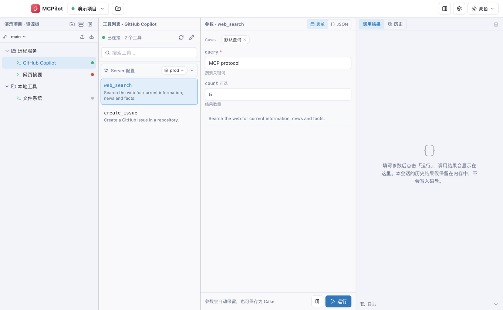
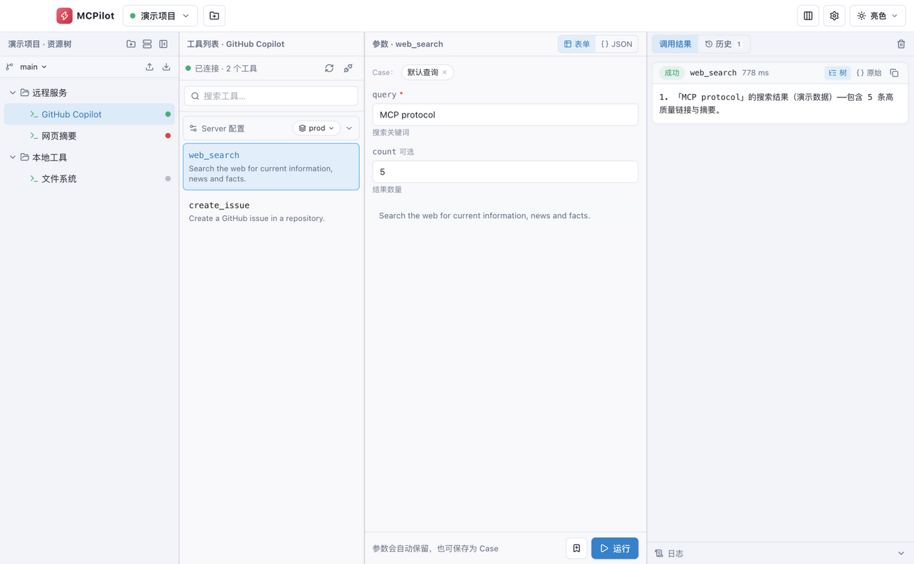
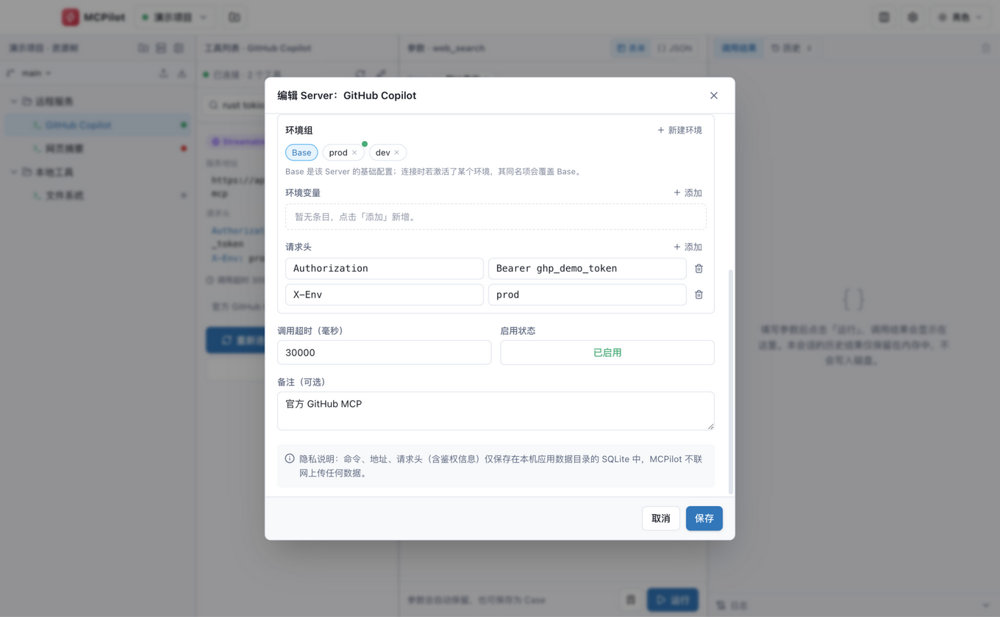

# MCPilot — 本地 MCP 调试工作台

MCPilot 是一个跨平台的 [MCP (Model Context Protocol)](https://modelcontextprotocol.io) Inspector 桌面客户端，基于 **Tauri 2 + React** 构建。

以「项目 → 目录 → Server」的方式组织你的 MCP Server，提供 **资源树 → 工具列表 → 参数表单 → 调用结果** 四栏工作台。



> **隐私承诺**：全部数据（项目/目录/Server 配置/请求头中的鉴权信息）仅保存在本机应用数据目录的 SQLite 中，应用不接入任何遥测/统计/上报，运行期间除你主动配置的 MCP Server 地址与同步仓库外不发起任何网络请求。

## 功能总览

### 项目与资源树

- 多项目管理，左上角随时切换；项目可绑定 **Git 同步目录**（自动 git init）
- 目录无限嵌套、拖拽移动、右键管理；展开/收起带动画，整栏可折叠
- Server 按协议类型着色标识（stdio 绿 / Streamable HTTP 紫）与连接状态点

### Server 连接

- **双传输**：stdio（本地子进程，可配参数/环境变量/工作目录）与 Streamable HTTP（远程）
- **自定义请求头**：Authorization 等鉴权信息，连接时自动携带
- **环境切换**：Server 级多套环境（dev/prod…），可从 Base、本 server 其他环境或**其他 server 的环境**克隆；激活后连接自动覆盖同名 env/headers
- 单击查看配置摘要（命令/URL/headers/超时），双击或点按钮才发起连接；支持一键重连

### 工具调用

- JSON Schema 自动生成参数表单（枚举下拉、默认值、必填校验），支持 表单 / JSON 双模式
- **参数自动保留**：跨工具切换、甚至重启应用后自动回填；可保存为命名 **Case** 一键带入
- 调用带超时保护；结果支持 JSON 折叠树 / 原始文本切换、结构化内容与入参对照、一键复制

### 调用历史

- 全局历史（跨工具/项目，200 条，仅内存）：搜索关键字（工具名/Server/入参），按 全部/当前 Server/当前工具 过滤，条目点击展开完整详情




### Git 同步

- **项目级**（资源树同步条）：分支切换、推送（导出+commit+push）、拉取（pull+覆盖导入）
- **全局级**（设置页）：全部项目导出/导入到统一仓库
- 仓库结构即项目：`tree.json` + `servers/<别名>.json`；只扫描 `.json`，损坏文件记入日志并跳过不加载；同目录 Server 别名不允许重名；默认**脱敏导出**（headers/env → `***`）

### 外观

- 亮色 / 暗色 / **跟随系统** 三态（实时响应系统切换），主色调天蓝




### 其他

- 可折叠日志面板：Git 同步、连接失败等运行记录（仅内存）
- 四栏宽度可拖拽 + 一键均分

## 界面说明

| 栏 | 内容 |
|---|---|
| 资源树 | 项目内目录/Server 树、同步条（分支/推送/拉取）、连接状态点 |
| 工具列表 | 选中 Server 的工具（搜索过滤）、连接状态、可折叠配置摘要与环境切换 |
| 参数 | Schema 表单 / JSON 双模式、Case 条、运行 |
| 调用结果 | 结果卡片、历史标签页、可折叠日志 |

## 开发

```bash
pnpm install
pnpm app:dev      # 开发模式（热更新，Ctrl+C 退出）
pnpm app          # 打包并运行产物
pnpm app:build    # 只打包不运行
```

依赖：Node 18+、pnpm、Rust stable（Tauri 官方要求）。

纯浏览器打开 `http://localhost:1420` 会进入**演示模式**（内置演示数据 mock，仅 dev 构建生效），便于 UI 开发与截图。

### 打包与系统要求

推送 `v*` 标签（如 `git tag v0.1.0 && git push origin v0.1.0`）触发 GitHub Actions（`.github/workflows/build.yml`）三平台自动打包，并创建 Release 附全部安装包：

| 平台 | 产物 | 最低系统版本 |
|---|---|---|
| macOS | `.app` / `.dmg`（universal：Intel + Apple Silicon 合包） | macOS 10.15+（Apple Silicon 机型实际要求 11+） |
| Windows | NSIS 安装包 / MSI（x64） | Windows 10+（WebView2 运行时要求） |
| Linux | `.deb` / `.rpm` / `.AppImage`（x64） | glibc 2.35+（Ubuntu 22.04+ / Debian 12+ / Fedora 36+） |

macOS 图标需保留官方网格边距（主体 824 居中）：`tauri icon` 后再执行 `node scripts/gen-macos-icns.mjs <1024源图>` 重新覆盖 `icon.icns`（`tauri icon` 会裁掉透明边距导致 Dock 图标偏大）。

手动触发（workflow_dispatch）也可以打包，产物在工作流的 Artifacts 里下载，不创建 Release。

### 数据存储位置

| 平台 | 路径 |
|---|---|
| macOS | `~/Library/Application Support/com.mcpilot.app/mcpilot.db` |
| Linux | `~/.local/share/com.mcpilot.app/mcpilot.db` |
| Windows | `%APPDATA%\com.mcpilot.app\mcpilot.db` |

### 内置示例 Server（examples/）

```bash
# Streamable HTTP 演示（端口 3927）
node examples/http-server.mjs
```

- `examples/stdio-server.mjs` — stdio 演示，提供 `echo` / `add` 两个工具；
- `examples/http-server.mjs` — Streamable HTTP 演示，提供 `upper` 工具，会校验 `Authorization` 头。

## 安全说明

- 所有 SQL 使用 prepared statement，防注入；git 命令参数数组执行
- 请求头 / 环境变量等敏感值不写日志、不出现在错误信息中（自动脱敏，含激活环境合并后的值）
- 已知取舍：敏感配置目前**明文存于本机数据库**（与官方 MCP Inspector 行为一致）；后续可接入操作系统 Keychain 做加密存储
- Tauri capability 最小化（仅 `core:default` + 窗口拖动），生产构建启用严格 CSP
